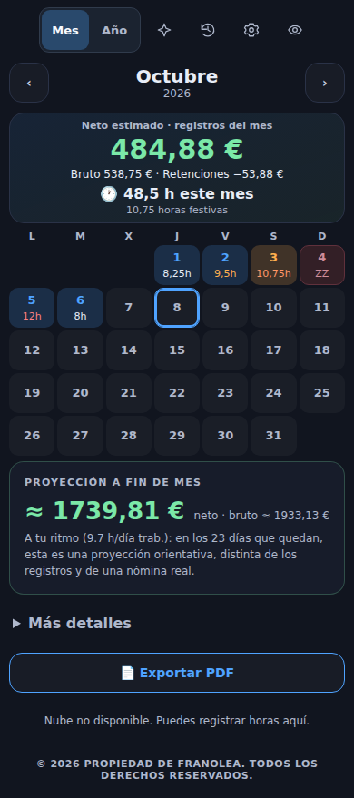
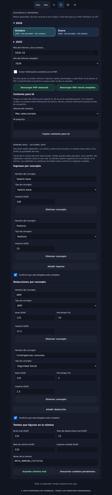

# Archivo maestro y respaldo

Versión previa publicada: `92bf4f8b07e0037438a2de326c798c7215c12b22`, árbol `7118ecfda019f53671eff79dc52e751a1c71c52d`. Respaldo completo verificado: https://github.com/FranOO1/misApps/tree/backup/mis-horas-publicada-20261014-92bf4f8 . Se conservan los respaldos anteriores, incluido backup/mis-horas-publicada-20261012-25cfb24. Capturas de Chromium del mismo árbol con datos ficticios:




El respaldo contiene todos los archivos versionados: código, estilos, configuración pública, referencias de dependencias, recursos y worker. No incluye servicios externos ni una exportación de registros privados. No se ha accedido ni exportado ningún dato real del usuario. Instantánea local de trabajo protegida aparte en /workspace/misApps-base-92bf4f8.

## Persistencia y actualización

El archivo es una representación derivada, no editable, reconstruible desde el payload original de cada cuenta. IndexedDB: base `mis-horas-historial-maestro`, almacén `cuentas`, clave de la cuenta actual. Si IndexedDB no está disponible, se usa la clave local `horas-master-v1:<cuenta codificada>`. Incluye schemaVersion 1, sourceVersion, updatedAt, cobertura, procedencia, originales completos, índice sin recortes, modelos mensuales, años y total global. Incluye notas, tramos, pausas, tipos, nóminas y ajustes registrados; no agrega credenciales de Firebase. Las tarifas desconocidas o sin confirmar se identifican; no se reconstruyen registros inexistentes.

Al cargar, guardar, importar o recibir cambios, se reconstruye o actualiza automáticamente. Antes de consultar se compara con el payload vigente. La copia incompleta no sustituye ningún archivo maestro, y no se responde hasta recuperar el historial completo. Los originales continúan en el almacenamiento/journal existente y users/{uid}; se sincronizan por el mecanismo existente y cada dispositivo reconstruye su propio archivo. No se duplica el archivo derivado en Firestore ni se cambia su esquema o reglas.

Exportación completa: Ajustes → Archivo maestro del historial → Exportar historial maestro JSON. Incluye notas y datos económicos; no equivale a la copia restaurable. La exportación restaurable existente permanece disponible. Un JSON maestro no se importa como registros automáticamente.

## Consultas conectadas al cliente

El cliente obtiene el plan validado, ejecuta consultar_periodo/totales/comparar_periodos/detalle sobre la versión actual del archivo, y pasa el resultado calculado a Gemini junto a executedFunction/sourceVersion. Es ejecución local real de funciones y entrega de resultados al SDK, no solo una instrucción textual al modelo. La conversación conserva el contexto, pero las cifras actuales sustituyen las antiguas. Nueva conversación borra el diálogo, no el archivo. Las cuentas se separan; el archivo no contiene tokens o claves. Las notas solo se envían si se solicitan expresamente. Los documentos nuevos conservan su vista previa y autorización.

Los cálculos usan HorasCore/HorasReports. Se preservan el periodo de trabajo/cobro de Sintax, las tarifas del periodo y los totales reales y estimados separados. Un mes sin nómina puede mostrar su estimación; ausencia no significa cero. No se recortan meses ni se utiliza el mes del calendario como límite. Si los registros cambian durante una respuesta, se descartan las cifras anteriores.

## Restaurar sin sustituir registros

Partir del main vigente:

```bash
git fetch origin
git switch -c restore/mis-horas-92bf4f8 origin/main
git restore --source=origin/backup/mis-horas-publicada-20261014-92bf4f8 --staged --worktree -- controlHoras gemini-prueba .github/workflows/mis-horas-ui.yml
```

Dar al CACHE de controlHoras/sw.js un nombre nuevo, comprobar la actualización de la PWA y publicar mediante PR. No borrar localStorage, IndexedDB o Firestore, ni importar datos antiguos. El esquema original sigue siendo 3; la versión anterior ignora la caché derivada, y conserva registros posteriores al respaldo.

## Verificación

153 pruebas Node locales: fuentes originales, primer mes, todos los periodos, sumas y comparación, estimación sin nómina, nómina real, edición/borrado/parámetros, reinicio, cuentas, copia incompleta y errores de persistencia. CI enlazado en el PR ejecuta Chromium, IndexedDB real, exportación JSON, PDF, PWA y dos navegadores con Firestore local. Los casos y capturas usan datos ficticios. SDK/Auth/App Check/Gemini de CI son simulados; no verifican Google ni reglas de producción.

La prueba gemini-prueba/historial.html utiliza el mismo cliente, cuatro consultas reales ficticias y funciones del maestro: primer mes, nómina real, todos los meses, corrección de una jornada y comparación de meses distantes. No lee el archivo del usuario ni conecta Firestore. El resultado real sigue pendiente hasta obtenerlo desde una sesión accesible. Configuración de Gemini, App Check, SDK y modelo conservados; sin facturación ni cambios en Plantómetro.

Se conserva también el menú compacto aprobado y el verde oscuro de mensajes propios, pendientes por el bloqueo de la entrega anterior.
