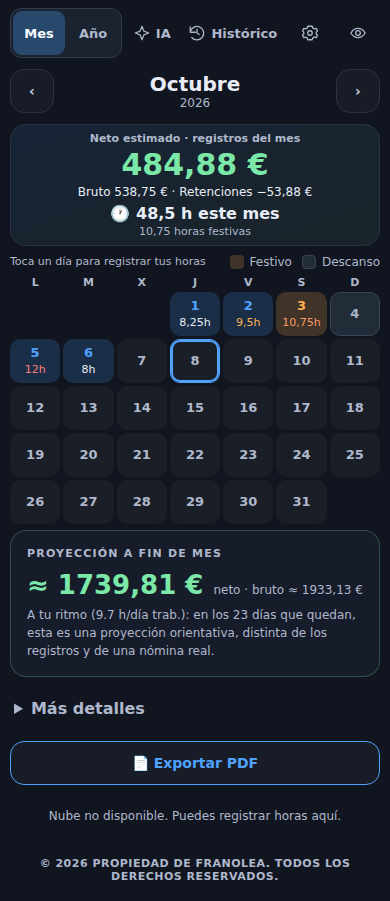
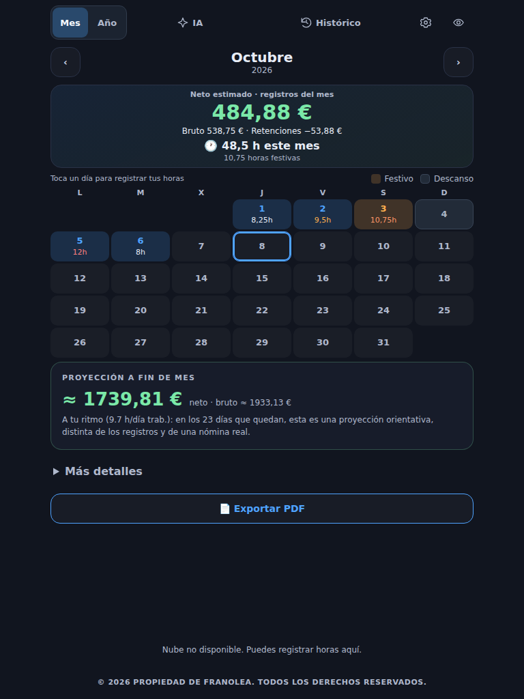

# Respaldo previo al ajuste económico del chat

Versión publicada: `ab19dc64ec23732affb551e78a46bc8e00db5dab`, árbol `397a2b957d4c7301b8bf6b4909fafd224c1569b4`.
Despliegue: https://github.com/FranOO1/misApps/actions/runs/38467098873
Respaldo completo del código: https://github.com/FranOO1/misApps/tree/backup/mis-horas-publicada-20261013-ab19dc6
El respaldo anterior backup/mis-horas-publicada-20261012-25cfb24 se conserva.

La rama se creó desde el commit publicado y se releyó para verificarlo. Incluye todos los archivos versionados: código, estilos, recursos, configuración pública, dependencias referenciadas y service worker. Los servicios Firebase y las bibliotecas externas no se copian por Git. La configuración administrativa de Gemini no se cambia.

## Capturas

Capturas de Chromium en el CI del mismo árbol publicado, con datos ficticios:



Referencias permanentes en backup/mis-horas-referencias-20261013. El directorio local /workspace/misApps-base-ab19dc6 protege también la instantánea de trabajo previa; no se usa para publicar cambios ajenos a este ajuste.

## Datos

El respaldo es de código y capturas. No se ha accedido a registros privados ni exportado datos reales. La exportación JSON restaurable de Ajustes permanece disponible. No se debe importar un JSON antiguo para recuperar el diseño.

## Restaurar y publicar sin sustituir registros

Partir del main vigente y recuperar solamente el código de Mis Horas:

```bash
git fetch origin
git switch -c restore/mis-horas-ab19dc6 origin/main
git restore --source=origin/backup/mis-horas-publicada-20261013-ab19dc6 --staged --worktree -- controlHoras gemini-prueba .github/workflows/mis-horas-ui.yml
```

Dar al CACHE de controlHoras/sw.js un identificador nuevo, ejecutar las comprobaciones, abrir un PR y publicar su fusión. No borrar localStorage, IndexedDB ni Firestore; no importar datos antiguos. Cerrar y abrir la PWA con conexión tras el despliegue. Ambas versiones conservan el formato de jornadas y nóminas; el código anterior debe poder leer registros añadidos después del respaldo. No tocar Plantómetro ni configuración administrativa de Firebase.

