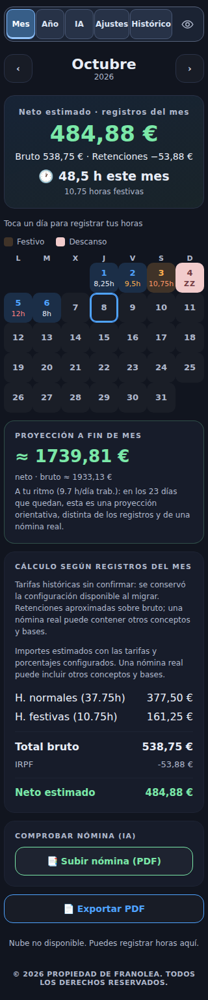
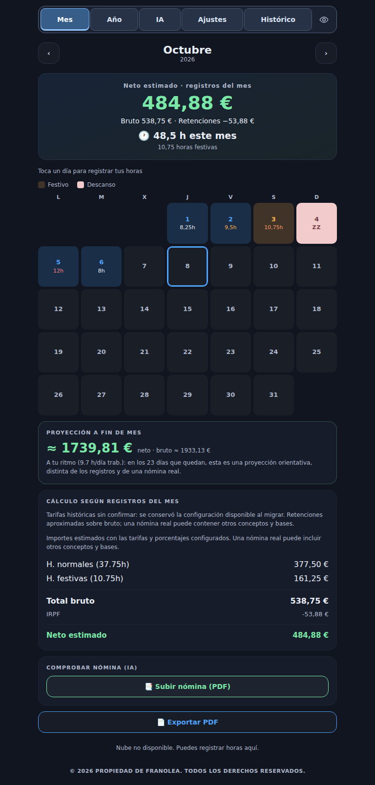

# Respaldo de Mis Horas antes del diseño compacto y chat histórico

Versión publicada comprobada: `25cfb2445e23898bfad8624b25dfad7c888ef6e3`, árbol `b40c579a2e06bf2bc7c5e0ab198d0ae0595cac9e`.
Despliegue correcto: https://github.com/FranOO1/misApps/actions/runs/38240204050

Respaldo completo del repositorio exactamente en ese commit:
https://github.com/FranOO1/misApps/tree/backup/mis-horas-publicada-20261012-25cfb24

La rama fue creada y releída: commit y árbol coinciden con main publicado. Contiene todos los archivos versionados, estilos, iconos, configuración pública, informes, formularios, workflows y service worker, incluyendo las referencias a dependencias externas usadas por esa versión. No se ha sustituido la configuración de Gemini ni App Check. Firebase, las APIs, el proveedor reCAPTCHA y los CDN son servicios externos, no forman parte de una copia Git ni quedan restaurados por ella.

Trabajo local que ya estaba pendiente cuando llegó la instrucción de respaldo: protegido aparte, sin mezclarlo con la versión publicada:
https://github.com/FranOO1/misApps/tree/backup/mis-horas-pendientes-20261012
Commit `1e13185551e4b8509a6a6c7a6185e8ac469004a6`. Es un borrador sin publicar ni verificar; no usarlo como versión estable.
Además se guardó un archivo local de trabajo en `/workspace/mis-horas-respaldo/20261012-25cfb24/cambios-pendientes-locales.tar.gz`.

## Referencias visuales

Las capturas del último CI correcto corresponden al mismo árbol de la versión publicada, usando datos ficticios y sin sesiones ni registros reales. Móvil 320 px y tablet 768 px:




Las pruebas finales de la nueva versión guardan sus propias capturas para comparar presentación, calendario y tamaño del formulario.

## Código y registros son copias distintas

Este respaldo contiene código y recursos, no los documentos privados de Firestore, las jornadas, las nóminas reales ni los datos locales del usuario. No se ha accedido a ellos ni se ha generado una exportación real. Las capturas y pruebas usan únicamente datos ficticios.

La exportación JSON restaurable de Ajustes se conserva. Para proteger registros reales, el usuario puede descargar su copia desde Ajustes en su navegador. No importar una copia antigua solo para cambiar el diseño: podría sustituir datos posteriores. Un PDF tampoco sustituye a la exportación restaurable.

## Volver al diseño publicado sin borrar datos

1. Descargar opcionalmente una copia JSON actual de los registros desde Ajustes antes de cualquier operación; guardar el archivo fuera de la PWA. Esta tarea no lo ha descargado por el usuario.
2. En una copia del repositorio, partir del main vigente y crear una rama nueva. Recuperar solo los archivos de Mis Horas y su workflow desde el respaldo, conservando el historial Git posterior:

```bash
git fetch origin
git switch -c restore/mis-horas-25cfb24 origin/main
git restore --source=origin/backup/mis-horas-publicada-20261012-25cfb24 --staged --worktree -- controlHoras gemini-prueba .github/workflows/mis-horas-ui.yml
```

3. Dar al CACHE de `controlHoras/sw.js` un identificador nuevo como `horas-v9-restauracion-FECHA`. Mantener el worker completo del respaldo. Así se solicita una instalación fresca del HTML anterior y sus recursos. No tocar localStorage, IndexedDB, los documentos de Firestore, las reglas administrativas, la facturación ni Plantómetro.
4. Ejecutar las pruebas de esa versión, incluida actualización de la PWA con una copia ficticia que contenga jornadas y nóminas añadidas después del respaldo. Abrir un PR de restauración, revisarlo, fusionarlo y confirmar que el despliegue Pages del nuevo commit termina correctamente.
5. Cerrar y volver a abrir la app con conexión. No borrar datos del navegador, reinstalar borrando almacenamiento ni restaurar JSON antiguo automáticamente.

Las mejoras nuevas de conversación son transitorias, no un cambio de formato de jornadas/nóminas. Ambas versiones usan schemaVersion 3 y el mismo almacenamiento por cuenta. La metadata nueva de carga del historial se ignora por el sincronizador anterior; no sustituye registros. La restauración de código debe comprobarse de nuevo si en el futuro cambia el esquema de datos.
